<div align="center">

# 🍿 Plex Re-View

**Your year on Plex, re-viewed.** A Spotify Wrapped-style recap for everyone on your Plex server,<br>
with a cinema-themed scrolling page, a server leaderboard, data stats and a shareable card.

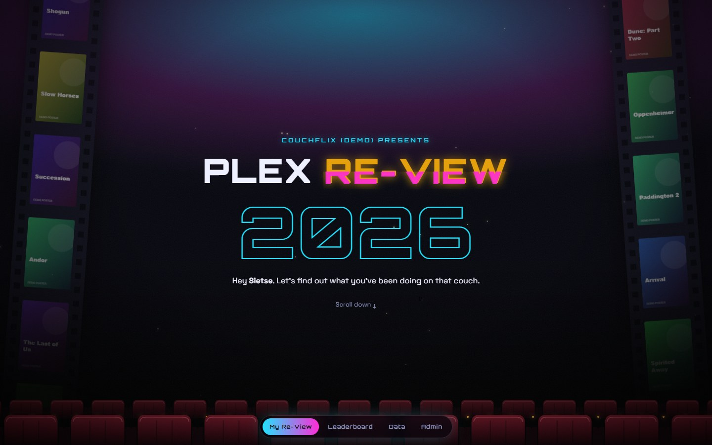

</div>

---

Your users sign in with their own **Plex account**, the stats come from **[Tautulli](https://tautulli.com/)**, and the whole thing runs as **one small Docker container** that you can deploy from Portainer in a couple of minutes. No database, no build step, no external dependencies.

> Screenshots in this README use the built-in demo with made-up data and placeholder posters. On a real server the posters are your actual library artwork.

## ✨ Features

### Your Re-View
One long page that comes alive as you scroll: sections slide, zoom and fade in, numbers count up and the colours shift from section to section. All with a sense of humour.

- **Total watch time** in hours and days, plus a breakdown of episodes, shows and movies
- **Year vs. last year**, comparing the same period while the year is still running
- **Top show and top movie** with real posters, plus your top 5 of each
- **Daily rhythm and seasons**: your peak hour, favourite day and busiest month
- **Biggest binge day** and **longest streak**
- **First and most recent play** of the year
- **Trusty sidekick**: the device you used most
- **Transcode shame**: how often your devices made the server sweat
- **The graveyard**: movies you quit before halfway
- **Server leaderboard rank** and your share of everything watched
- **Taste twin**: the person on your server whose taste matches yours best
- **Viewer personality**: Night Owl, Binge Machine, Loyalist, Cinephile and more
- **Save my card 📸**: a 1080×1920 image of your year, ready for WhatsApp or Instagram stories

### Leaderboard
Everyone on the server ranked by hours watched, the **top 25 shows** and **top 25 movies** with how many people watched them, and a **Transcode shame** ranking.

### Data
How much the server has streamed to people **outside your home**, in total and per year (in MB, GB, TB and PB), with fun facts ("that's 245 years over a 56k modem") and **server records**: longest single session, most people watching at once, total plays and new movies and shows added this year.

### Admin
Server totals, watch time per month, devices, every user (including the ones who never press play) and a button to open anyone's Re-View.

### And also
- 🎬 Dark cinema look: film strips with your library's posters, rows of seats and film grain
- 📱 Works on phones and desktops
- 🔐 Plex sign-in. Only people who have access to your server (according to Tautulli) can get in
- 🗓️ Look back at previous years with the year picker
- ♿ Respects "reduce motion" settings

## 📸 Screenshots

| | |
|---|---|
| 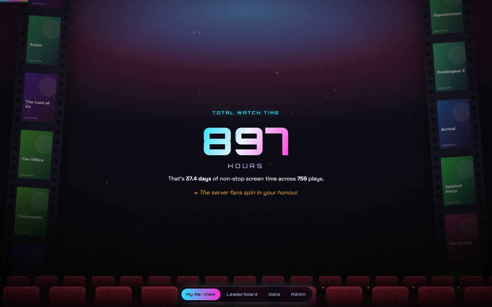 | 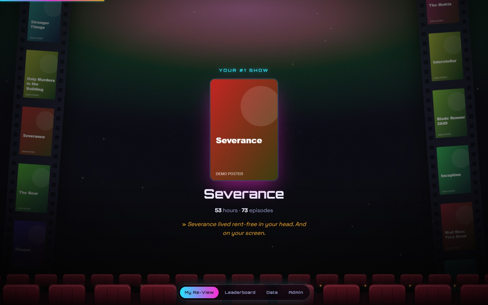 |
| 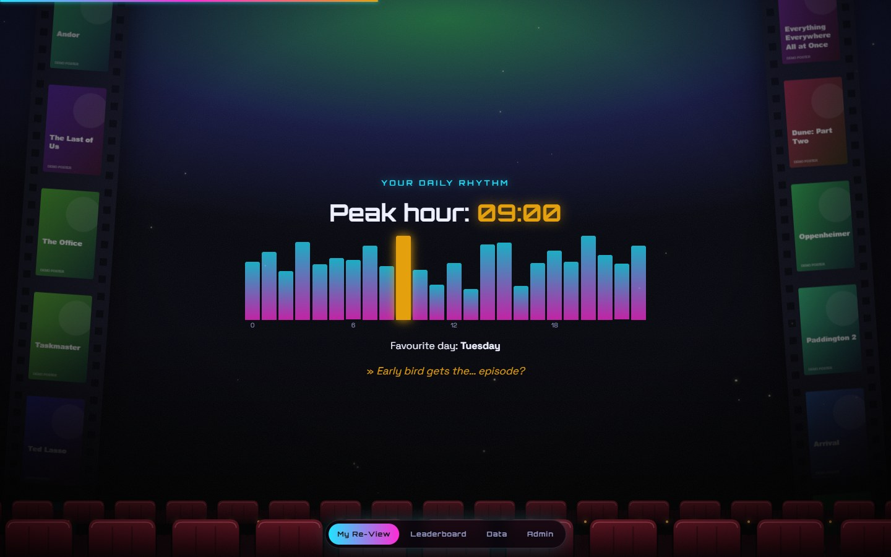 | 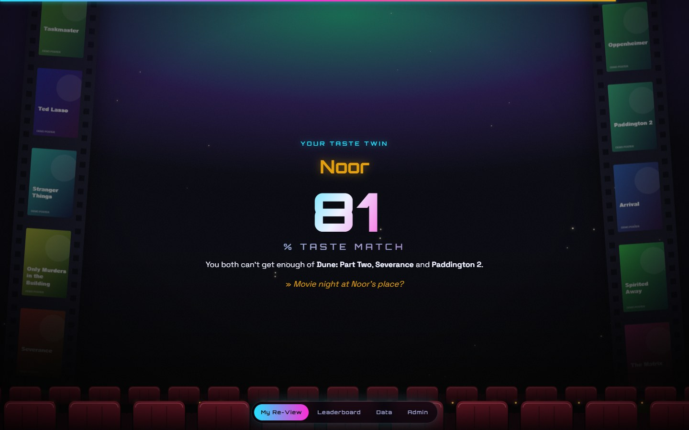 |
|  | 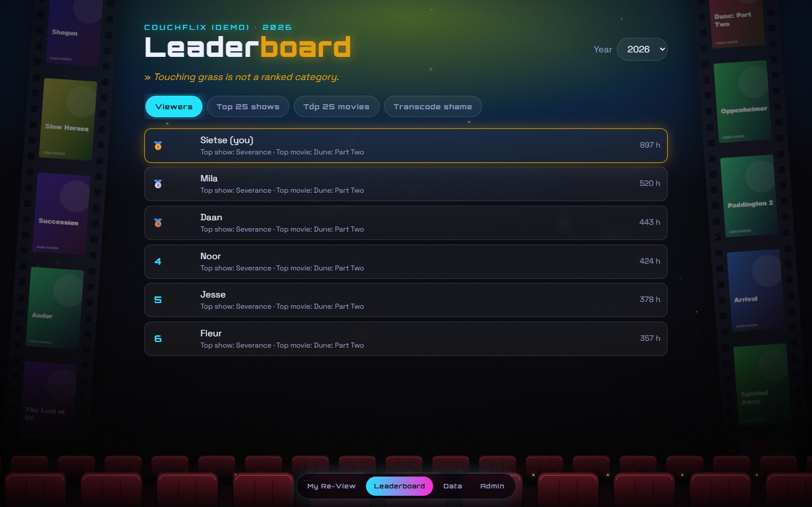 |
| 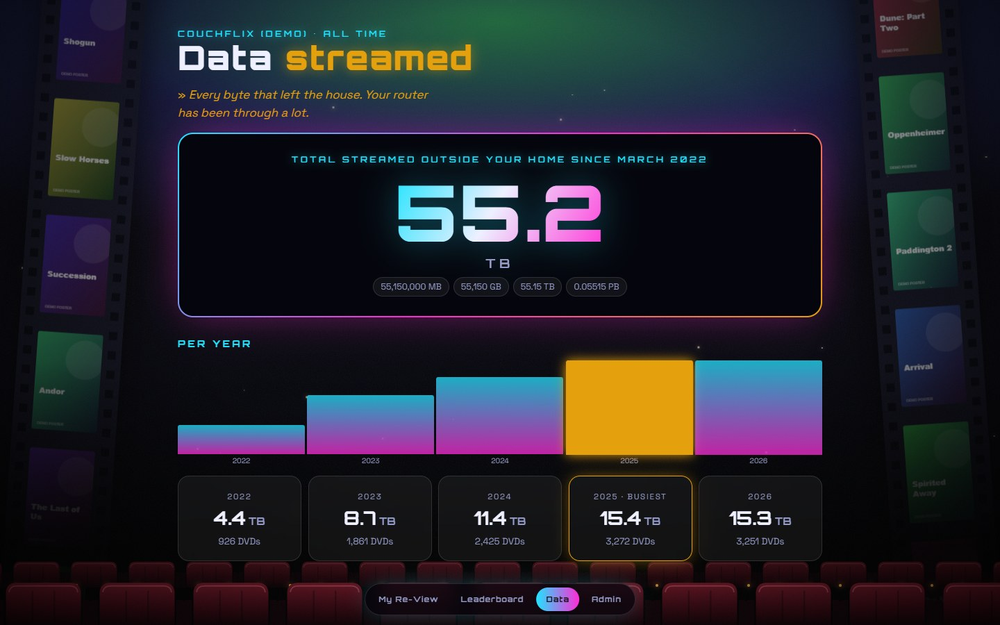 | 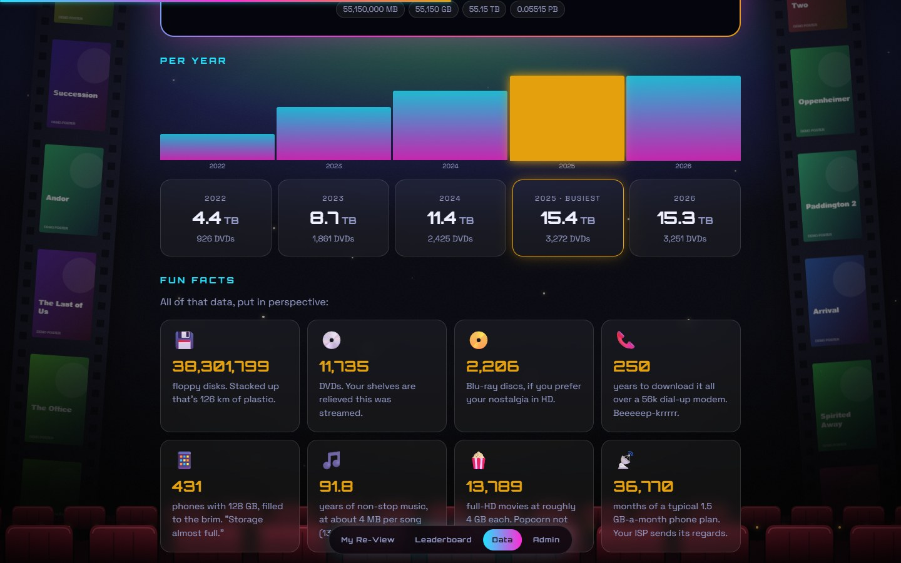 |
| 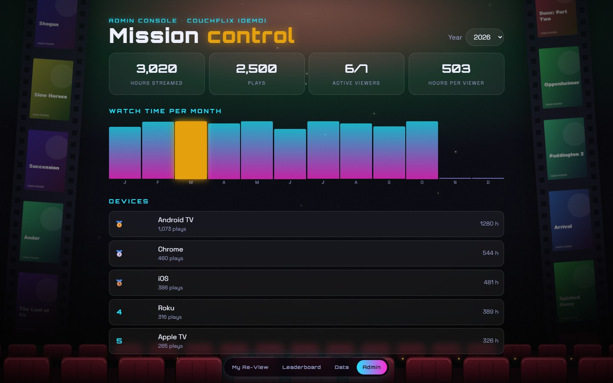 | |

<table>
  <tr>
    <td>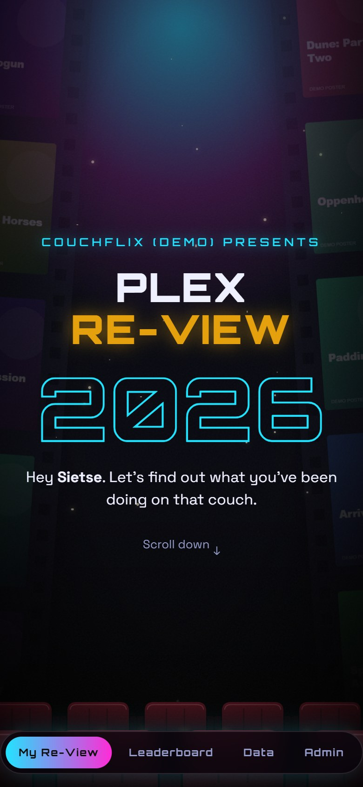</td>
    <td>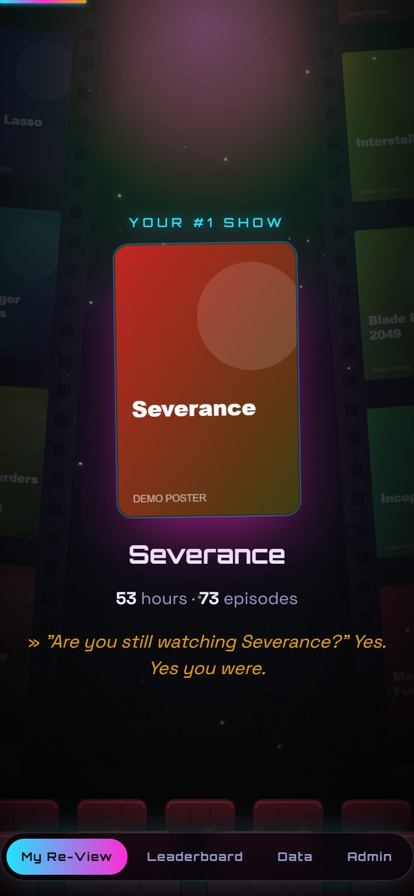</td>
    <td>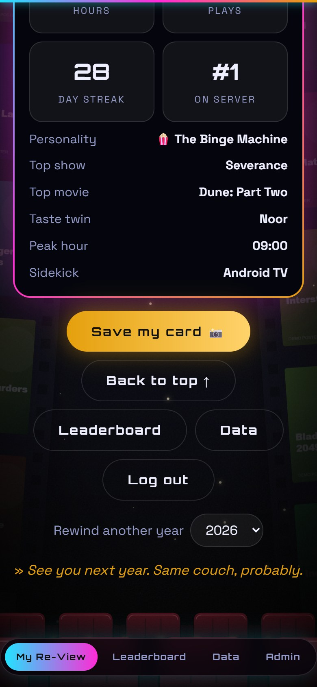</td>
    <td>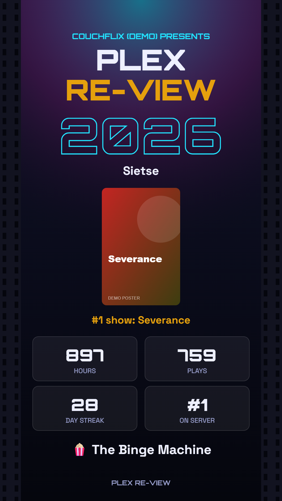</td>
  </tr>
  <tr>
    <td align="center">On a phone</td>
    <td align="center">Scroll-in sections</td>
    <td align="center">Summary</td>
    <td align="center">The share card</td>
  </tr>
</table>

## 📋 Requirements

- **Docker** (standalone, not Swarm), optionally with **Portainer** CE 2.x
- **Plex Media Server**
- **Tautulli** connected to that Plex server, with its API enabled
- **Plex Pass**, only for the Data page (Plex keeps bandwidth statistics only for Plex Pass servers)
- Viewers need a Plex account that has access to your server

## 🚀 Deploy with Portainer

1. Collect your settings first. See [Finding your settings](#-finding-your-settings) below.
2. In Portainer, go to **Stacks → Add stack** and give it a name, e.g. `plex-review`.
3. Choose **Repository** as the build method and fill in:
   - **Repository URL:** `https://github.com/Sietsevdm/Plex_Re-View`
   - **Repository reference:** `refs/heads/main`
   - **Compose path:** `docker-compose.yml`
4. Under **Environment variables**, add your settings one by one, or switch to **Advanced mode** and paste them in `.env` format:
   ```
   TAUTULLI_URL=https://tautulli.example.com
   TAUTULLI_API_KEY=your-tautulli-api-key
   SESSION_SECRET=a-long-random-string
   TZ=Europe/Amsterdam
   PLEX_URL=https://plex.example.com
   PLEX_TOKEN=your-plex-token
   ```
5. Click **Deploy the stack**. Portainer downloads the code and builds the image (the first time takes a minute).
6. Open `http://<your-docker-host>:8080` and sign in with Plex.

If a required setting is missing, the deploy stops with a message like *"required variable TAUTULLI_URL is missing a value"*.

### Updating

Open the stack in Portainer and click **Pull and redeploy**. The image is rebuilt from the latest code on every deploy. If you'd like updates to happen automatically, turn on **GitOps updates** on the stack.

### Or with plain Docker Compose

```bash
git clone https://github.com/Sietsevdm/Plex_Re-View.git
cd Plex_Re-View
cp .env.example .env   # then fill in your values
docker compose up -d
```

To update later: `git pull && docker compose up -d`.

## ⚙️ Configuration

| Variable | Required | What it does |
|---|---|---|
| `TAUTULLI_URL` | ✅ | How the container reaches Tautulli. Include a base URL such as `/tautulli` if you use one. |
| `TAUTULLI_API_KEY` | ✅ | Tautulli's API key. |
| `SESSION_SECRET` | ✅ | A long random string you make up. Signs the login cookies. |
| `TZ` | | Time zone for peak hours, days and streaks, e.g. `Europe/Amsterdam` ([list](https://en.wikipedia.org/wiki/List_of_tz_database_time_zones)). Default `Europe/Amsterdam`. |
| `PORT` | | Port on the Docker host. Default `8080`. |
| `PLEX_URL` | | Your Plex server. Enables the Data page and the "added this year" record. |
| `PLEX_TOKEN` | | The server owner's Plex token. Needed together with `PLEX_URL`. |
| `ADMIN_USERS` | | Extra admins: Plex usernames (not emails), comma-separated. The server owner is always admin. |

### 🔑 Finding your settings

**`TAUTULLI_URL`**: the address you open Tautulli on, as seen **from the Docker host** (not from your laptop).
- Same machine or network: something like `http://192.168.1.10:8181`
- Same Docker network: `http://tautulli:8181` (the container name)
- Hosted somewhere else (a seedbox, VPS or Appbox): use its `https://` address
- Running Tautulli under a sub-path? Include it: `https://example.com/tautulli`

To test it, open this in a browser. It should answer with `"result": "success"` and your server's name:
`<TAUTULLI_URL>/api/v2?apikey=<TAUTULLI_API_KEY>&cmd=get_server_friendly_name`

**`TAUTULLI_API_KEY`**: in Tautulli go to **Settings → Web Interface**, scroll to **API**, tick **Enable API**, save, and copy the **API key**.

**`SESSION_SECRET`**: you don't look this up anywhere; you make it up. Nobody ever has to type it. Any long random string works. Generate one:
- Windows (PowerShell): `-join ((48..57) + (65..90) + (97..122) | Get-Random -Count 48 | ForEach-Object { [char]$_ })`
- Linux / macOS: `openssl rand -hex 32`

Keep it the same afterwards: changing it logs everyone out (they just sign in again).

**`PLEX_URL`**: the address of your Plex Media Server, as seen from the Docker host.
- Plex on your own network: `http://192.168.1.10:32400`
- Plex hosted elsewhere (seedbox, Appbox, VPS) or behind a reverse proxy: use the **`https://`** address. Avoid plain `http://` over the internet, because your Plex token travels along with every request.

To test it, open `<PLEX_URL>/identity`. A working Plex address shows a small response with a `machineIdentifier`.

**`PLEX_TOKEN`**: must belong to the **server owner's** Plex account.
1. Open Plex Web and sign in as the owner.
2. Open any movie or episode, click **⋯ → Get Info → View XML**.
3. The address of the page that opens ends with `X-Plex-Token=...`. Everything after the `=` is your token.

Plex explains it here as well: [Finding an authentication token](https://support.plex.tv/articles/204059436-finding-an-authentication-token-x-plex-token/). Treat the token like a password: it gives full access to your Plex server.

### Reverse proxy and HTTPS

Plex Re-View listens on port `8080` over plain HTTP. To reach it from outside your home, put it behind a reverse proxy with HTTPS (Nginx Proxy Manager, Traefik, Caddy, …) and make sure the proxy sends `X-Forwarded-Proto: https`, so the login cookie is marked `Secure`. Plex sign-in works on any address, so no extra Plex configuration is needed.

## 🔍 How it works

```
Browser ──► Plex Re-View (Node, one container) ──► Tautulli API   (watch history, users, posters)
   │                    │                     └──► Plex server     (bandwidth stats, library counts; optional)
   └── signs in at plex.tv; the server checks the account is a user in Tautulli
```

- **`public/index.html`**: the entire frontend in one HTML5 file (HTML, CSS and plain JavaScript).
- **`server.js`**: a small Node server with **zero npm dependencies**. It handles the Plex sign-in, keeps your API key and token server-side, proxies posters and caches answers.
- **`stats.js`**: turns raw watch history into the yearly stats. Covered by tests (`npm test`).
- **`dev/demo.js`**: a fake Tautulli and Plex for trying the app without a real server.

Good to know:
- Stats are calculated from Tautulli's watch history, so they go back as far as Tautulli has been running. The year picker shows the last five years.
- Answers are cached for 10 minutes (server records for 30). Admins can click **Refresh data from Tautulli** on the Admin page to clear the cache straight away.
- The first page load after a (re)start is slower, because a whole year of history is fetched once.
- Plex Re-View only **reads** from Tautulli and Plex; it never changes anything.
- Movies and TV shows only; music is not included.

### Privacy and security
- Users sign in with Plex. Only accounts that exist in Tautulli (people you share your server with) get in; anyone else sees *"you're not on this server's guest list"*.
- Your Tautulli API key and Plex token never reach the browser. Posters go through the app's own image proxy, and only for signed-in users.
- Everyone signed in can see the leaderboard, including names, hours, favourite titles and taste twins.
- The Data page shows **server totals only**, never per person, and counts **remote streams only**. Watching on your own home network doesn't count. If your Plex is hosted elsewhere (seedbox, Appbox), practically every stream is remote.
- Sessions are signed cookies, valid for 30 days. Nothing is stored on disk.
- Never commit your `.env` file. It's already in `.gitignore`.

## 🛠️ Troubleshooting

| What you see | What to do |
|---|---|
| Deploy fails: *"required variable … is missing a value"* | Add that variable under the stack's Environment variables. |
| *"Sorry …, you're not on this server's guest list"* | That Plex account isn't a user in Tautulli. In Tautulli, open **Users** and refresh the user list, then sign in again. |
| *"Login expired, try again"* | The sign-in took longer than 15 minutes, or cookies are blocked. Click **Sign in with Plex** again. |
| No **Admin** item in the menu | Admin is the server owner according to Tautulli. Add your Plex username to `ADMIN_USERS` and redeploy. |
| *"Something broke. Check the server logs."* | Open the container's logs in Portainer. Usually `TAUTULLI_URL` or `TAUTULLI_API_KEY` is wrong; test them with the link in [Finding your settings](#-finding-your-settings). |
| Posters are empty frames | Tautulli can't fetch artwork from Plex. Check Tautulli's own Plex connection (Settings → Plex Media Server). |
| Data page: *"Streamed data isn't set up yet"* | Add `PLEX_URL` and `PLEX_TOKEN`. |
| Data page: *"Plex refused the bandwidth statistics"* | The token isn't the owner's, or the server has no Plex Pass. Check that `<PLEX_URL>/identity` works. |
| Data page shows little or no data | Plex keeps bandwidth history for a limited time, and only remote streams count. |
| A server record card is missing | That part couldn't be fetched (for example on an older Tautulli version). The other cards still work. |
| Peak hours or days are off | Set `TZ` to your time zone. |
| New plays don't show up yet | Data is cached for 10 minutes. Wait, or use **Refresh data from Tautulli** on the Admin page. |

## ❓ FAQ

**Is the Data page per user?** No. It's the whole server's total of remote streams, split per year.

**Does it work for previous years?** Yes, use the year picker on your Re-View, the leaderboard or the Admin page. It goes back as far as your Tautulli history does.

**Can users see each other's stats?** On the leaderboard, yes: names, hours, top titles and transcode percentages. Someone's full Re-View is only visible to themselves and to admins.

**Do I need Plex Pass?** Only for the Data page and the "added this year" record. Everything else works without it.

**Can I change the port?** Set `PORT`, e.g. `PORT=8095`, and open `http://<host>:8095`.

## 🧪 Try it locally

The demo runs a fake Tautulli and Plex with made-up users, plays and posters. No real server needed:

```bash
npm run demo
```

Open http://localhost:8181 and pick who to log in as (the demo skips the Plex sign-in; Sietse is the admin). The demo is not included in the Docker image.

Against your real Tautulli (and optionally Plex), without Docker:

```bash
TAUTULLI_URL=http://192.168.1.10:8181 TAUTULLI_API_KEY=xxx SESSION_SECRET=dev node server.js
```

Then open http://localhost:8080. Plex sign-in works on localhost too. Requires Node 20 or newer. Run the tests with `npm test`.

## 🙏 Inspiration

Plex Re-View was inspired by these great projects:

- [plex-unwrapped](https://github.com/mihavidakovic/plex-unwrapped) by mihavidakovic
- [plex-rewind](https://github.com/RaunoT/plex-rewind) by RaunoT
- [Wrapperr](https://github.com/aunefyren/wrapperr) by aunefyren

## 📄 License

[MIT](LICENSE): free to use, change and share, also commercially, as long as the copyright notice is kept.

---

<sub>Not affiliated with or endorsed by Plex Inc. or Tautulli. Plex is a trademark of Plex Inc.</sub>
